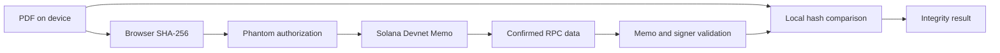

# Proofly — Hackathon submission

**Tagline:** Trust Every Document. Verify On-Chain.

**Short description:** Proofly is a privacy-first infrastructure layer for independently verifiable digital document proofs. It anchors SHA-256 PDF fingerprints on Solana while keeping document contents on the user's device.

## Problem and solution

PDFs are easy to modify and difficult to compare against a reliably recorded version. Centralized verification portals require their operator to remain available and often collect sensitive files. Proofly creates a public, independently readable fingerprint record while keeping the original private. Anyone with the exact file and transaction signature can check byte-for-byte integrity.

## Technical description

The Next.js App Router application uses Web Crypto to hash PDF bytes entirely client-side. Wallet Standard discovery connects Phantom through Solana wallet adapters. A web3.js v1 transaction invokes the official Memo Program with a versioned Proofly SHA-256 memo and the connected wallet as required signer. RPC confirmation is tied to the submitted blockhash validity window. Verification reads actual Devnet transaction status and raw instruction data, validates execution success, memo format, program ID, and signer binding, then compares the recorded fingerprint with a local document hash. Public proof URLs, QR codes, downloadable JSON receipts, and browser-local history support sharing and follow-up checks. No custom program, database, document-upload endpoint, or custodial keys are required.

## Why Solana

Solana provides low-cost transactions, fast confirmation, a widely supported wallet ecosystem, and a public Memo Program that makes a small versioned integrity record independently readable. Devnet allows a hackathon demonstration without spending real SOL. Mainnet migration would require reliability review, fee communication, dedicated RPC infrastructure, and explicit network separation.

## Target users and business model

Universities comparing certificates, businesses recording deliverables and reports, and organizations handling confidential agreements. A future paid API/SDK could support organization-issued proofs, integration workflows, managed indexing, and batch registration. Basic public verification should remain open. This MVP has no billing or institutional identity verification.

## Architecture

## Roadmap

1. Validate real signed Devnet demonstrations, mobile wallets, and dedicated RPC reliability.
2. Add an optional organization identity and issuer verification layer, clearly separated from document integrity.
3. Build an integration SDK, batch workflows, indexing, and version chains.
4. Audit protocol handling and deploy a network-separated Mainnet release.

## Demo video script (about 2 minutes)

**0:00–0:20:** Show the landing page. “Documents travel through emails, downloads, and edits. How do we know the file we received still matches the version someone recorded? Proofly makes that check independently verifiable.”

**0:20–0:55:** Connect a funded Phantom Devnet wallet and choose a PDF. Show its SHA-256 fingerprint, approve the real transaction, and wait for confirmation. “The PDF stays on this device. Only this fingerprint is recorded, signed by my wallet.” Open the real Solana Explorer transaction.

**0:55–1:25:** Copy the public proof URL and open it in a browser without a connected wallet. Upload the original PDF. Show Verified and the recording wallet. “Anyone can read the transaction and compare the bytes. They do not need to trust our database.”

**1:25–1:45:** Upload a modified PDF. Show Mismatch. “Even a small change gives a different fingerprint. The check detects the change.”

**1:45–2:00:** Show dashboard and receipt. “Proofly verifies integrity, not legal validity or issuer identity. It is a privacy-first foundation for universities and businesses to build verifiable document workflows.”

Use actual confirmed transactions in the recording. Do not substitute illustrations for a working registration or claim Mainnet operation. Add the actual GitHub and demo URLs after publishing.
